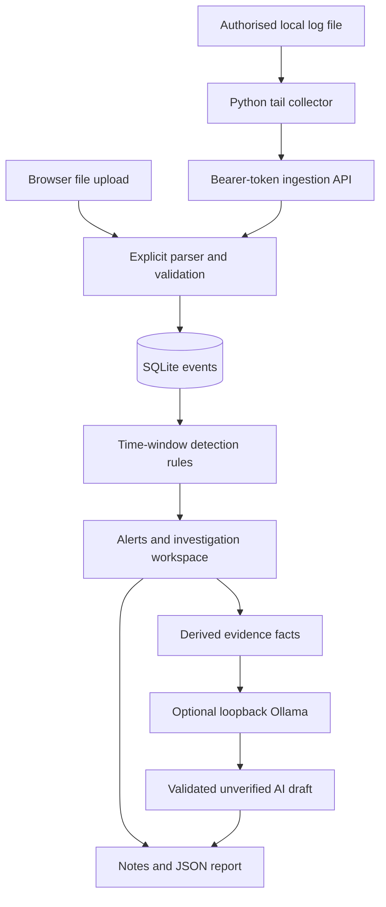

# ◈ CyberSentinel — Milestone 2
### Local security monitoring, live file collection and incident investigation

A cybersecurity portfolio lab that turns authentication, web and network logs into explainable alerts, evidence timelines and documented investigations. This version adds **raw log adapters**, **a live local file collector**, and **optional local Ollama summaries** to the working Milestone 1 application.

**Already running Milestone 1? Start with [the Windows upgrade guide](docs/UPGRADE.md).** Preserve your `instance` folder before upgrading. The guide includes the exact live-demo and AI setup commands.

## Scope and value
Designed for cybersecurity students and junior SOC analysts practising the path from raw events to investigation. Demonstrates Python, SQL, detection engineering, parser design, ingestion reliability, authentication, role checks, API tokens, and cautious use of model-generated assistance. It is an educational local prototype, not a production SIEM or a system-wide sensor.

| Capability | Current implementation |
|---|---|
| Ingestion | Manual uploads and authenticated local HTTP collection |
| Formats | Normalised JSONL; supported OpenSSH syslog outcomes; Apache/Nginx common/combined access log; Zeek TCP/UDP conn JSON |
| Detection | Four deterministic time-window rules; explainable priorities and evidence IDs |
| Dashboard | Trends, filters, optional 10-second refresh, event explorer |
| Investigation | Status, attributed notes, JSON reports, activity history |
| Collector | Newline-aware tailing, ACK-based checkpoint, retry, basic rotation/truncation detection, health and revocation |
| Optional AI | Local Ollama adapter, validated output structure/reference IDs, separated unverified drafts |

## Architecture

Python/Flask keeps the backend inspectable. Jinja/HTML/CSS avoids a frontend build pipeline or CDN. SQLite supports local transactional persistence. Waitress serves the app without debug mode. The collector and AI adapter use Python's standard library and require no new Python runtime dependencies. The model runtime and weights are optional, separately installed software.

## New installation — Windows PowerShell
Open PowerShell in this folder, beside `run.py`. Python 3.11 or 3.12 is intended; automated execution was verified with 3.12. Use the Python version installed on your computer.
```powershell
py -3.11 -m venv .venv
.\.venv\Scripts\python.exe -m pip install -r requirements-lock.txt
.\.venv\Scripts\python.exe -m flask --app sentinel:create_app create-user analyst
.\.venv\Scripts\python.exe run.py
```
Choose a password of at least 12 characters. Open http://127.0.0.1:8000 and sign in. There is no default password. A read-only account uses `create-user observer --role viewer`.

Linux/macOS: use `python3.12 -m venv .venv`, then `.venv/bin/python` in place of the Windows executable.

## First demonstration
Click **Load synthetic demo**. A fresh database shows **75 events, 4 alerts, 4 active incidents, 2 high/critical alerts**. Investigate AUTH-002, inspect the failed/successful logins, add a note, and download the JSON report. Reloading the same fixture adds no duplicates.

For live collection, follow [UPGRADE.md, section C](docs/UPGRADE.md). The synthetic writer appends seven lines to a real file while a separate collector forwards them; no login attack or network scan is performed. Each run creates two new authentication alerts using a distinct lab account.

## Rules and interpretation
| Rule | Trigger | Scope | Score |
|---|---|---|---|
| AUTH-001 | ≥5 failed logins in 300 seconds | Source IP + account | 70, high |
| AUTH-002 | Success after ≥5 failures within 300 seconds | Source IP + account | 90, critical |
| NET-001 | ≥10 distinct destination ports in 60 seconds | Source + destination IP | 65, medium |
| WEB-001 | ≥8 distinct HTTP 404 paths in 60 seconds | Source IP | 50, medium |

Scores are fixed triage priorities, **not probabilities**. Legitimate scanners, broken clients, shared/NAT addresses and user mistakes may trigger rules. A suspicious pattern is not proof of compromise. Windows include their endpoints and use event time in UTC.

Alerts are suppressed to one per rule/scope/UTC date. Evidence captures the first threshold crossing at initial creation; later imports do not revise existing evidence/status. Late records can therefore produce different first-crossing evidence in a clean replay. Subsequent same-day episodes may be suppressed. Events remain visible. Content hashing collapses identical records, including legitimately identical repeats; trustworthy source event IDs are a future improvement.

## Input formats and boundaries
| Format | Accepted subset / timestamp handling |
|---|---|
| jsonl | Existing schema: timestamp, kind, src_ip plus kind-specific fields |
| ssh | `sshd[PID]` or `sshd-session[PID]`; Failed/Accepted password, publickey or keyboard-interactive/pam; ISO with timezone or traditional syslog with explicit year and UTC offset |
| apache | Common or combined access format with numeric IP; `METHOD target HTTP/version`; English month abbreviation and numeric timezone |
| zeek | JSON conn records with numeric ts, id.orig_h, id.resp_h, integer id.resp_p; tcp/udp |

Known non-authentication sshd messages and Zeek ICMP records are skipped **with a count**. Unknown/malformed formats reject the entire batch; mixed non-sshd `auth.log` files should be filtered or adapted explicitly. Zeek TSV, PCAP, Windows Event Logs, arbitrary custom access formats, and nginx error logs are not supported. Raw uploaded lines are normalised, not retained verbatim; preserve originals separately if needed.

Traditional SSH records have no year or timezone; the app will not infer them. A single batch must use the correct year and fixed offset. Split data at year or daylight-saving offset changes. ISO timestamps remove this ambiguity.

Example normalised input:
```json
{"timestamp":"2026-10-15T08:00:00+00:00","kind":"auth","src_ip":"192.0.2.20","user":"student","outcome":"failure"}
{"timestamp":"2026-10-15T08:00:01+00:00","kind":"web","src_ip":"192.0.2.20","path":"/missing","status":404}
{"timestamp":"2026-10-15T08:00:02+00:00","kind":"network","src_ip":"192.0.2.20","dst_ip":"192.0.2.100","dst_port":443}
```
Limits: 2 MiB HTTP request, 2,000 nonblank lines/batch, 16,384 characters/line, 10,000 stored events. Auth user is 1–80 characters; web path is 1–2048; status is integer 100–599; destination port is integer 1–65535. All records are validated before insertion. No uploaded data is executed.

## Collector reliability and permissions
- CLI creates a random ingest-only token; only its SHA-256 digest is stored in the DB. Token files are excluded from Git/Docker and must stay private.
- Token owner must remain an analyst. Revoke from the Collectors page; tokens cannot read incidents or modify their status.
- Endpoint: POST `/api/collect`, JSON `{logs, format, year?, offset?}`, Authorization Bearer token. Empty logs are a heartbeat. Limit: 60 requests/minute/token. Browser login cookies cannot replace the token.
- A collector sends up to 200 lines / 128 KiB per cycle; default interval two seconds. Newline-incomplete data waits. The checkpoint advances after server acknowledgment and is atomically replaced. Network failures retry with bounded backoff; rejected formats/authentication stop with a message.
- Checkpoint is bound to source path, parser settings and endpoint. OS locking prevents concurrent use of one checkpoint. Server content deduplication handles replay after an ACK-loss or crash.
- Rotation/truncation detection uses file identity, length and a hash immediately before the checkpoint. It is not a lossless log shipper: unread bytes in a renamed file, extremely rapid rotation, same-prefix rewrites, or source deletion can lose data. Retain originals and use a mature shipper for production.
- A heartbeat indicates recent contact, not completeness. New-event counters can undercount if the server crashes after event commit but before updating health; detection persistence remains transactional.
- Local IPv4 loopback only. No background service installer, remote transport/TLS, automatic file discovery or Windows Event Log subscription is included.

## Optional AI
Enable with `CYBER_AI=1` and set `CYBER_AI_MODEL` (default `qwen2.5:1.5b`). It calls only `http://127.0.0.1:11434/api/generate`, disables proxies/redirects, and requests a non-streaming JSON response. Ollama and the selected local model must already be installed. There is no paid API requirement and no automatic model download.

The prompt contains derived counts, timestamps, controlled rule IDs and up to 30 evidence IDs. It excludes arbitrary usernames, IPs, paths, raw lines and analyst notes. Output is size/shape checked and every cited ID must exist in the supplied evidence. **These checks do not validate factual accuracy or eliminate prompt-injection/model risks.** All generated prose is escaped, labelled unverified, stored separately, and never used to execute actions, change scores or close cases. Only one generation runs at a time per app process. Requests time out after 90 seconds; failure leaves the case unchanged. Actual inference was not run in the build environment.

## Data model and migrations
Exact DDL: `sentinel/schema.sql`. Startup creates missing tables without deleting existing rows.
| Table | Key data |
|---|---|
| users | Unique username, salted password hash, role |
| events | SHA-256 content ID, indexed UTC timestamp, kind, source, normalised body |
| alerts | Stable ID, rule, score, explanation, JSON evidence IDs, status |
| notes | Alert FK, actor, timestamp, status/note text |
| audit | Local actor/action history |
| attempts | Per-IP login request window |
| collectors | Unique name, analyst FK, token digest, revocation, heartbeat and counters |
| event_sources | Event FK + collector FK, unique pair |
| ai_summaries | Alert FK, actor/time/model, generated draft and exact derived facts |

Evidence ID arrays use application-managed references, not relational foreign keys. There is no event deletion UI. Local audit/history is not tamper-resistant.

## Project layout
```text
sentinel/          Flask application, parsers, rules, AI adapter, schema, templates/CSS
collector/tail.py  Live local file collector and checkpoint handling
samples/           Synthetic JSONL/raw fixtures, generators and live writer
tests/             Detection, routes, ingestion, collector and AI-contract tests
docs/UPGRADE.md    Windows migration and feature walkthrough
docs/VALIDATION.md Actual verification and unverified areas
docs/SECURITY.md   Security boundaries
docs/DEMO.md       Presentation guidance
run.py             Loopback Waitress launcher
requirements*.txt  Dependency baseline and test requirements
Dockerfile         Optional non-root container
compose.yaml       Persistent data volume and loopback port
```

## Tests
```powershell
.\.venv\Scripts\python.exe -m pip install -r requirements-dev.txt
.\.venv\Scripts\python.exe -m pytest -q
```
Delivered result: **44 passed** on Linux/Python 3.12. Includes real local HTTP tailing/resume plus mocked AI transport and failure cases. Original benign fixture: zero alerts across 46 events; no real-world false-positive rate is claimed. See [validation](docs/VALIDATION.md).

## Optional Docker
```bash
docker compose build
docker compose run --rm sentinel flask --app sentinel:create_app create-user analyst
docker compose up -d
```
The volume persists accounts and data. `docker compose down -v` permanently deletes it. Docker execution was not verified here. This guide recommends native Windows execution for all three new features: container-to-host Ollama wiring is not supplied. AI stays disabled in the default Compose setup.

## Security and configuration
- `CYBER_DB`: DB path; default `instance/sentinel.db`.
- `CYBER_SECRET`: optional random signing-key override ≥32 characters; otherwise a persistent random `.secret` file is created beside the DB. Protect the directory and Windows ACLs.
- `CYBER_HTTPS=1`: Secure session cookie when deliberately deploying behind HTTPS; leave off for local HTTP.
- Passwords use salted scrypt. Sessions: HttpOnly/SameSite Strict, one-hour inactivity timeout, CSRF for browser POSTs. Token-authenticated API is separately guarded, not cookie-authenticated.
- Parameterised SQL, autoescaped HTML, restrictive CSP, no-store responses, upload limits, per-IP login throttle, analyst/viewer permissions.
- No MFA, tenant isolation, encrypted DB, server-side stolen-cookie revocation, authenticated original log provenance, production monitoring or formal penetration test. Do not expose this lab directly to the public internet.

## Troubleshooting
| Problem | Check |
|---|---|
| Existing login missing | Copy the complete old instance folder before first launch; check CYBER_DB override |
| Collector says file unavailable | Check quoted path and read permissions; start the synthetic writer if using the demo |
| Token rejected | Check correct DB/token, revocation, and analyst ownership; create a new named collector if needed |
| Parser rejects file | Choose matching format, UTF-8 and explicit traditional SSH year/offset |
| Counts do not increase | Identical records deduplicate; daily alert suppression applies |
| No live dashboard update | Enable live view; collector terminal must remain running |
| AI unavailable | Check Ollama, installed model, CYBER_AI in server PowerShell, and native host execution |
| 429 login | Wait five minutes from the start of the current IP attempt window |
| CSRF error | Reload and sign in again; old tabs can have stale tokens |

## Roadmap
Next: broader parser coverage, native Windows event ingestion, reliable rotation draining, PostgreSQL/background jobs, evolving alert evidence, retention, MFA/session revocation, and a real-data evaluation. Local model quality must be evaluated before making performance claims.

## Primary references
- [Apache common and combined log formats](https://httpd.apache.org/docs/2.4/mod/mod_log_config.html.en)
- [Zeek connection logs](https://docs.zeek.org/en/current/reference/logs/conn.html)
- [Ollama generate API](https://docs.ollama.com/api/generate)
- [Qwen2.5 model family](https://ollama.com/library/qwen2.5)
- [Flask web security](https://flask.palletsprojects.com/en/stable/web-security/)

The dependency pins are a reproducible baseline, not a claim of latest releases or absence of vulnerabilities. No code has been published to GitHub or LinkedIn automatically.
